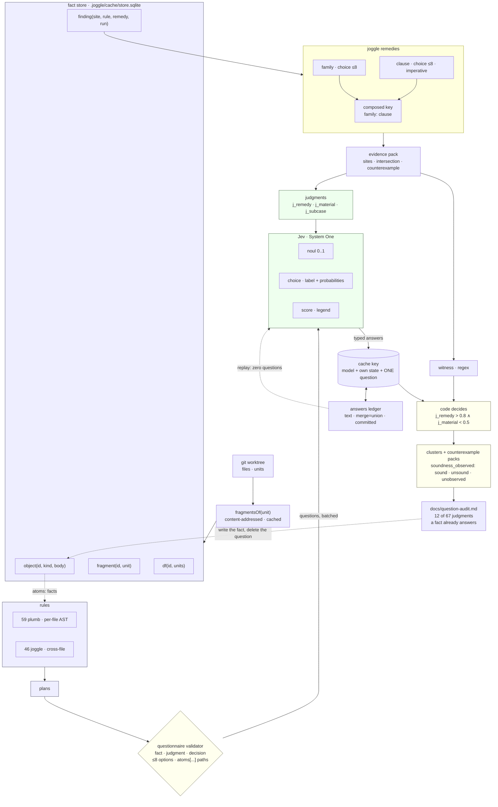

# How the tool works now

One picture of the pipeline as it stands after the remedy hill (rungs 0-4).

```
                    sources (a git worktree; no state of its own)
                                   |
                                   v
                 fragmentsOf(unit)  -- content-addressed, cached
                                   |
   +------------------- fact store: .joggle/cache/store.sqlite -------------------+
   |  object(id, kind, body)   fragment(id, unit)   df(id, units)                 |
   |  finding(site, rule, remedy_hash, run)      answers: the text ledger below    |
   +----------------+------------------------------------------+-------------------+
                    | atoms (facts)                            | findings
                    v                                          v
   +---------------------------------+        +------------------------------------+
   | rules: 59 plumb (per-file AST)  |        | joggle remedies                    |
   |        46 joggle (cross-file)   |        |   family (choice, <=8)             |
   +----------------+----------------+        |   clause (choice, <=8, imperative) |
                    | plans                   |   composed key: "family: clause"   |
                    v                         +--------+---------------------------+
   +---------------------------------+                 | evidence pack
   | questionnaire validator         |                 v
   |   fact | judgment | decision    |      +-----------------------------+
   |   every question <=8 options    |      | witness  (regex, deterministic) |
   |   every instruction names an    |      | judgment (j_remedy, j_material, |
   |   atoms[...] path               |      |           j_subcase)            |
   +----------------+----------------+      +-------+---------------------+---+
                    | questions, batched             |                     |
                    v                                v                     |
   +--------------------------------------------------------------------------------+
   | Jev, System One:  noul (0..1)  choice (label+probabilities)  score   |
   | every answer cached by  model + own state + ONE question -> replay  |
   +----------------+---------------------------------------------------------------+
                    | typed answers
                    v
   +-----------------------------------+        +----------------------------------+
   | code decides                      |        | answers ledger (.joggle/answers) |
   |   j_remedy > 0.8 and j_material   |<------>| text, merge=union, committed      |
   |   < 0.5 -> merge; else independent|        | the replay that makes a judgment  |
   +----------------+------------------+        | as reproducible as a function    |
                    v                           +----------------------------------+
   +-----------------------------------+
   | clusters + counterexample packs   |
   |   which sites one rule reaches    |
   |   that the other cannot, computed |
   | soundness_observed:               |
   |   sound | unsound | unobserved    |
   +-----------------------------------+
```

## The four layers, and why each exists

| layer           | answers                                                                              | cost                                |
| --------------- | ------------------------------------------------------------------------------------ | ----------------------------------- |
| **facts**       | what the workspace already knows: fragments, document frequency, import edges, types | paid once, in the store             |
| **questions**   | what genuinely needs a model: intent, acceptable variation, which reading            | one per distinct question, replayed |
| **decisions**   | which answers add up to a finding: thresholds, family boundaries, merge rules        | free, and visible                   |
| **observation** | whether the decision was right: `soundness_observed` after a fix                     | one re-run, diffed by the store     |

The ordering is the whole design: **a judgment may refine a decision, never widen it.** A pair
question can close an edge inside a family and cannot cross one. When the layers are inverted the
tool asks 17,364 questions to answer 1,431 (the rung-2 regression), and when they are in order 1,424
of 1,431 need no judgment at all.

## The loop it closes

```
  slop at the edge  ->  conformance finds it  ->  clusters by repair  ->  one fix, N sites
        ^                                                                       |
        |                                                                       v
  the rule that would have caught it  <-  a fact that replaces a judgment  <-  lesson
```

That last arrow is the point of `docs/question-audit.md`: 12 of 67 judgments are asking for a fact
the workspace already holds, and each one is named with the fact that would replace it.


