# Diagrams

One panel per scope. A graph draws edges: a part that renders nothing and is rendered by
nothing is in `MENU.md`, not here.

`pele` refuses a source over 50,000 characters or 5,000 edges. A view too large to draw
as one graph is contracted to its owners first — one node per scope, edges for the
compositions that cross a boundary, counts on both — and then drawn as small multiples
of the scopes it is made of: the owner, then the page. The atlas below is the join: the
overview and its children in one reading order.

A panel is also held well below `pele`'s guards: past a few hundred edges a graph is a
hairball even when it fits. When a scope exceeds the legibility budget it is drawn at the
next smaller scope instead. A scope that composes nothing is a row in the table below and
a line in `MENU.md`, not a picture; an entry point that nothing imports is still a scope,
but a flat route file is grouped with its route segment rather than drawn one panel per
URL.

Grayscale is tier (darker is more primitive); the one accent is a hook; a dashed edge is
a call rather than a render.

| scope       | nodes | edges | files                                                  |
| ----------- | ----: | ----: | ------------------------------------------------------ |
| composition |    14 |    16 | [source](./composition.mmd) · [svg](./composition.svg) |
| hooks       |     9 |     5 | [source](./hooks.mmd) · [svg](./hooks.svg)             |
| owners      |     9 |    10 | [source](./owners.mmd) · [svg](./owners.svg)           |

## composition

### composition

[source](./composition.mmd)

## hooks

### hooks

[source](./hooks.mmd)

## owners

### owners

[source](./owners.mmd)
